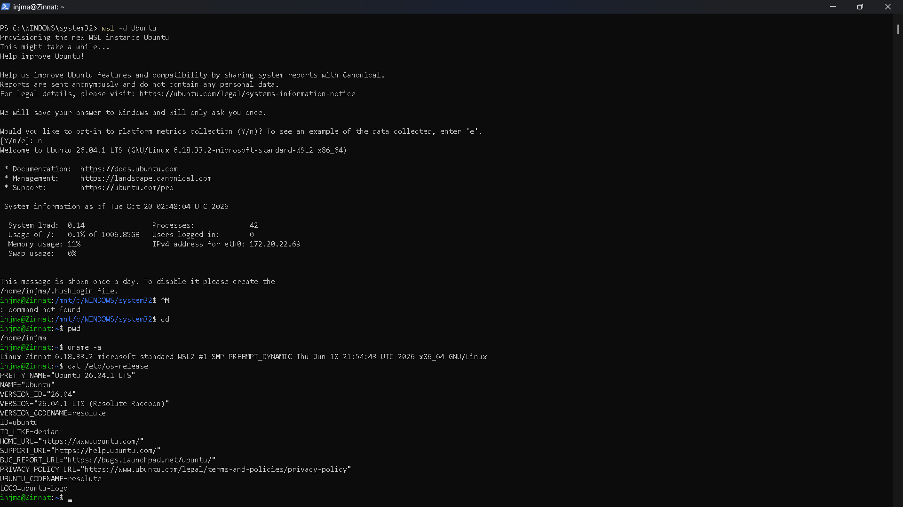
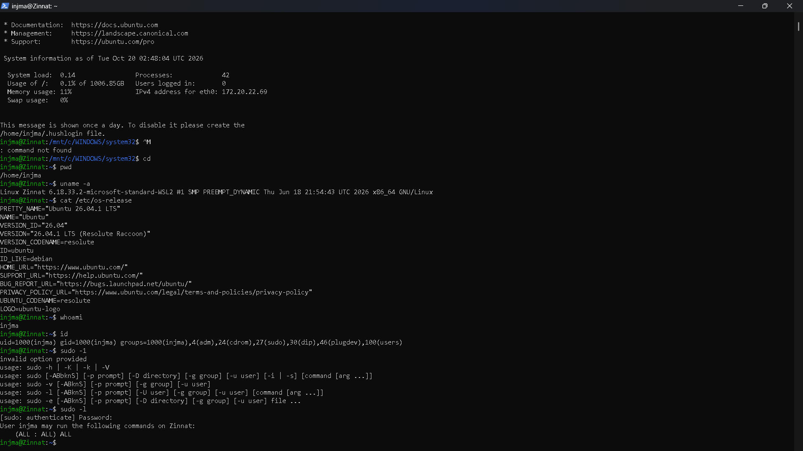
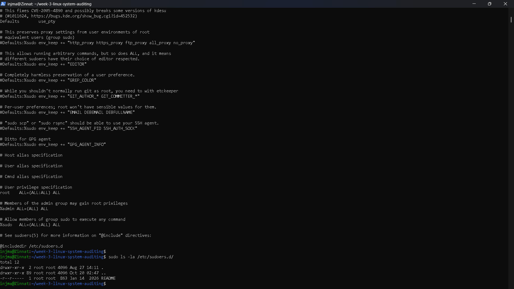
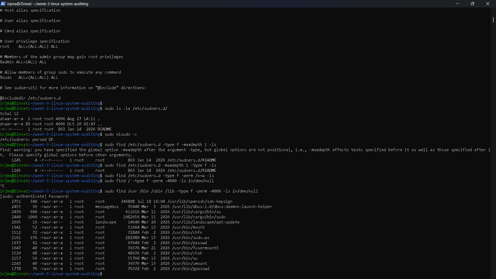

# Week 3 — Linux System Auditing & Security Assessment


---

## Internship

**GetIntern.in — 8-Week Practical Cybersecurity Track**

---

# 1. Objective

The objective of this Week 3 task was to perform a basic **Linux system security audit** within an authorized personal WSL2 environment.

The assessment focused on reviewing:

- Linux user and group privileges
- Sudo configuration
- User sudo privileges
- Sudoers configuration
- Sudoers file and directory permissions
- SUID-enabled binaries
- File ownership and permission controls
- Potential privilege-related security risks
- Basic Linux security hardening practices

The purpose of this assessment was to understand how administrative privileges are configured in Linux and how incorrect permissions or excessive privileges can increase security risk.

---

# 2. Tools & Environment

| Category | Details |
|----------|---------|
| Operating System | Ubuntu 26.04.1 LTS |
| Platform | Windows Subsystem for Linux 2 (WSL2) |
| Kernel | Linux 6.18.33.2-microsoft-standard-WSL2 |
| Shell | Bash |
| Primary User | `injma` |
| Privilege Tool | `sudo` |
| Configuration | `/etc/sudoers` |
| Additional Configuration | `/etc/sudoers.d/` |
| Audit Method | Linux command-line security auditing |

---

# 3. Authorized Scope

All auditing activities were performed in a controlled personal WSL2 environment for educational and cybersecurity learning purposes.

The assessment was limited to the local Linux environment.

```text
Target Environment:
Ubuntu 26.04.1 LTS
WSL2
User: injma
Kernel: 6.18.33.2-microsoft-standard-WSL2
```

No external systems, public IP addresses, or unauthorized devices were targeted.

The assessment was focused only on local Linux privilege configuration, file permissions, and SUID security controls.

---

# 4. Methodology

The Linux security assessment was performed in multiple stages.

### Step 1 — User and Group Privilege Review

The current user's identity and group memberships were reviewed using:

```bash
id
```

This was used to determine the user's UID, GID, and membership in administrative groups.

### Step 2 — Sudo Privilege Review

The current user's effective sudo privileges were reviewed using:

```bash
sudo -l
```

This command was used to determine which commands the user was authorized to execute with elevated privileges.

### Step 3 — Sudo Configuration Review

The main sudoers configuration was reviewed to understand how administrative privileges were assigned.

```bash
sudo cat /etc/sudoers
```

### Step 4 — Sudoers Syntax Validation

The sudoers configuration was validated using:

```bash
sudo visudo -c
```

This checks whether the sudoers configuration can be successfully parsed.

### Step 5 — Sudoers Permission Audit

The `/etc/sudoers.d/` directory and its files were reviewed for ownership and permission configuration.

```bash
sudo ls -la /etc/sudoers.d/
```

A specific check for world-writable sudoers files was also performed:

```bash
sudo find /etc/sudoers.d -type f -perm /o+w -ls
```

### Step 6 — SUID Binary Audit

SUID-enabled executables were identified using:

```bash
sudo find /usr/bin /sbin /lib -type f -perm -4000 -ls 2>/dev/null
```

The results were reviewed to identify privileged executables and determine whether they appeared to be standard system utilities.

---

# 5. User & Group Privilege Review

The current Linux user's identity and group membership were examined using:

```bash
id
```

The audit confirmed the following environment information:

```text
uid=1000(injma)
gid=1000(injma)
groups=1000(injma),4(adm),24(cdrom),27(sudo),30(dip),46(plugdev),100(users)
```

### Observation

The `injma` user is a member of the `sudo` group.

Membership in the `sudo` group allows the user to execute commands with elevated administrative privileges according to the system's sudo configuration.

The user was also identified as a member of several standard Ubuntu groups such as:

- `adm`
- `cdrom`
- `dip`
- `plugdev`
- `users`

### Security Consideration

Administrative group membership should be limited to trusted users because unnecessary administrative privileges can increase the impact of account compromise.

---

# 6. Sudo Configuration Audit

The primary sudo configuration was reviewed using:

```bash
sudo cat /etc/sudoers
```

The relevant configuration contained:

```text
root ALL=(ALL:ALL) ALL
%admin ALL=(ALL) ALL
%sudo ALL=(ALL:ALL) ALL

@includedir /etc/sudoers.d
```

### Observation

The configuration allows:

- `root` to execute commands with full privileges.
- Members of the `admin` group to use sudo according to the configured rule.
- Members of the `sudo` group to execute commands with elevated privileges.
- Additional sudo configuration files to be loaded from `/etc/sudoers.d/`.

### Security Consideration

The `@includedir` configuration means that additional privilege rules may exist outside the primary `/etc/sudoers` file.

Therefore, `/etc/sudoers.d/` should also be reviewed during a complete sudo security audit.

---

# 7. Sudo Privilege Audit

The effective sudo privileges of the current user were reviewed using:

```bash
sudo -l
```

The audit confirmed:

```text
User injma may run the following commands on Zinnat:
    (ALL : ALL) ALL
```

### Observation

The `injma` user has broad administrative sudo privileges in the test environment.

This means the user can execute commands as other users, including root, when authenticated through sudo.

### Security Risk

Broad administrative privileges increase the potential impact if the user account or authentication credentials are compromised.

### Security Recommendation

Administrative privileges should follow the **principle of least privilege** wherever practical.

Users should only receive the elevated privileges required for their responsibilities.

---

# 8. Sudoers Syntax Validation

The sudoers configuration was validated using:

```bash
sudo visudo -c
```

The validation returned:

```text
/etc/sudoers: parsed OK
```

### Observation

The sudoers configuration was successfully parsed.

This indicates that the primary sudoers file did not contain a syntax error that would prevent it from being parsed by the sudo configuration parser.

### Security Importance

A malformed sudoers configuration can potentially cause administrative access problems.

Using `visudo` for validation helps reduce the risk of introducing syntax errors into sudo configuration.

---

# 9. Sudoers Permission Audit

The `/etc/sudoers.d/` directory was reviewed using:

```bash
sudo ls -la /etc/sudoers.d/
```

The directory and configuration files were checked for ownership and permissions.

A specific audit for world-writable sudoers files was performed using:

```bash
sudo find /etc/sudoers.d -type f -perm /o+w -ls
```

### Result

The world-writable sudoers file check returned no results.

### Observation

No files inside `/etc/sudoers.d/` were identified as world-writable by the performed check.

This is a positive security configuration because unauthorized users should not be able to modify sudo policy files.

### Security Consideration

If an unprivileged user could modify a sudoers configuration file, they could potentially alter privilege rules and obtain unauthorized administrative access.

---

# 10. SUID Binary Audit

SUID-enabled binaries were identified using:

```bash
sudo find /usr/bin /sbin /lib -type f -perm -4000 -ls 2>/dev/null
```

The audit identified several SUID-enabled executables.

Examples included:

```text
/usr/bin/sudo.ws
/usr/bin/passwd
/usr/bin/su
/usr/bin/mount
/usr/bin/umount
/usr/bin/chfn
/usr/bin/chsh
/usr/bin/gpasswd
/usr/bin/fusermount3
/usr/lib/openssh/ssh-keysign
/usr/lib/dbus-1.0/dbus-daemon-launch-helper
```

Additional SUID-enabled paths were also observed under:

```text
/usr/lib/cargo/bin/
```

### Understanding SUID

The SUID permission allows an executable to run with the effective privileges of the file owner.

For example, a root-owned SUID executable may execute with root-level privileges even when launched by a non-root user.

### Security Consideration

SUID programs are not automatically malicious.

Many standard Linux utilities legitimately require SUID permissions to perform privileged operations.

However, unnecessary, modified, vulnerable, or incorrectly owned SUID binaries can create privilege-escalation risks.

Therefore, SUID files should be periodically reviewed.

---

# 11. Security Findings

The assessment produced the following findings:

| Finding | Observation | Security Impact |
|---------|-------------|-----------------|
| Administrative sudo access | `injma` has broad sudo privileges | High |
| Sudoers syntax | Configuration parsed successfully | Low / Positive |
| Sudoers world-writable files | None identified | Low / Positive |
| SUID binaries | Multiple standard SUID utilities identified | Medium |
| Sudoers include directory | `/etc/sudoers.d/` is enabled | Requires regular review |
| Administrative group membership | User belongs to `sudo` and other system groups | Medium |

### Key Observation

The most significant privilege-related finding was the user's broad sudo authorization:

```text
(ALL : ALL) ALL
```

This is expected in many personal Ubuntu environments, but from a security-hardening perspective it represents powerful administrative access.

---

# 12. Risk Assessment

The findings were classified according to their potential security impact.

| Finding | Risk Level | Reason |
|---------|------------|--------|
| Broad sudo privileges | High | Compromise of the account could provide administrative control |
| SUID binaries | Medium | Vulnerable or unnecessary SUID programs may enable privilege escalation |
| Sudoers include directory | Medium | Misconfigured files could modify privilege policy |
| Standard sudo configuration | Low | Configuration was successfully parsed |
| World-writable sudoers files | Low / Positive | No world-writable sudoers files were identified |

> Note: Risk classifications represent an initial security assessment. They do not confirm the presence of an exploitable vulnerability.

---

# 13. Security Hardening Recommendations

Based on the audit results, the following security controls are recommended:

1. Follow the **principle of least privilege** when assigning sudo access.

2. Review members of the `sudo` and `admin` groups regularly.

3. Avoid granting administrative privileges to unnecessary accounts.

4. Keep `/etc/sudoers` and `/etc/sudoers.d/` protected from unauthorized modification.

5. Use `visudo` when modifying sudoers configuration.

6. Regularly audit SUID-enabled binaries.

7. Remove unnecessary SUID permissions when they are not required.

8. Verify the ownership of privileged executables.

9. Keep Linux packages and security-sensitive utilities updated.

10. Review unusual privileged binaries against their installed packages before treating them as suspicious.

11. Monitor administrative configuration changes where appropriate.

12. Use strong authentication and secure account-management practices.

---

# 14. Evidence

The audit evidence collected during the assessment is stored in the `screenshots/` directory.

## Sudo Configuration

```text
screenshots/01-sudo-configuration.png
```

This screenshot provides evidence of the reviewed sudoers configuration.

## Sudo Privilege Audit

```text
screenshots/02-sudo-privilege-audit.png
```

This screenshot provides evidence of the user's effective sudo privileges.

## SUID Binary Audit

```text
screenshots/03-suid-binaries-audit.png
```

This screenshot provides evidence of the identified SUID-enabled binaries.

## Sudoers Permission Audit

```text
screenshots/04-sudoers-permission-audit.png
```

This screenshot provides evidence of the `/etc/sudoers.d/` permission review.

---

# 15. Screenshots

## 15.1 — Sudo Configuration Audit



---

## 15.2 — Sudo Privilege Audit



---

## 15.3 — SUID Binary Audit



---

## 15.4 — Sudoers Permission Audit



---

# 16. Project Structure

The project repository is organized as follows:

```text
week-3-linux-system-auditing/
│
├── README.md
│
└── screenshots/
    ├── 01-sudo-configuration.png
    ├── 02-sudo-privilege-audit.png
    ├── 03-suid-binaries-audit.png
    └── 04-sudoers-permission-audit.png
```

The repository contains the assessment documentation and visual evidence collected during the practical audit.

---

# 17. Limitations

This assessment was intentionally limited to basic Linux privilege and permission auditing.

- The assessment was performed only inside a personal WSL2 Ubuntu environment.
- No external systems were assessed.
- No exploitation was performed.
- No privilege escalation attack was attempted.
- No password attacks were performed.
- No credential attacks were performed.
- No persistence mechanisms were tested.
- No malware analysis was performed.
- SUID binaries were identified but not exploited.
- The assessment focused primarily on sudo configuration and privileged file permissions.

Therefore, the results should not be interpreted as a complete Linux penetration test or vulnerability assessment.

---

# 18. Ethical & Safety Statement

This activity was conducted for cybersecurity learning and internship practice within an authorized personal WSL2 environment.

The assessment was limited to:

- Linux privilege auditing
- Sudo configuration review
- Permission auditing
- SUID enumeration
- Security hardening analysis

**No exploitation, password attacks, brute-force attempts, credential attacks, unauthorized access, or privilege escalation were performed.**

All findings are intended for educational, defensive, and security-awareness purposes.

---

# 19. Skills Demonstrated & Conclusion

## Skills Demonstrated

Through this Week 3 exercise, I practiced:

- Linux system auditing
- Linux user and group analysis
- Sudo privilege auditing
- Sudoers configuration review
- Sudoers syntax validation
- Linux file permission analysis
- File ownership verification
- SUID binary enumeration
- Privilege-risk identification
- Security hardening analysis
- Evidence collection
- Technical cybersecurity documentation
- Ethical security assessment practices

## Conclusion

The Week 3 Linux System Auditing exercise successfully examined administrative privileges, sudo configuration, sudoers permissions, and SUID-enabled binaries within an authorized WSL2 Ubuntu environment.

The assessment demonstrated how Linux privilege configurations can affect system security and how improper permissions or excessive administrative access may increase security risk.

The exercise also provided practical experience in using Linux command-line tools to collect security evidence, interpret permission settings, identify privileged executables, and develop basic security-hardening recommendations.

All activities remained within the defined authorized scope, and no exploitation or unauthorized access was performed.

---

## Week 3 — Linux System Auditing & Security Assessment: Completed ✅
